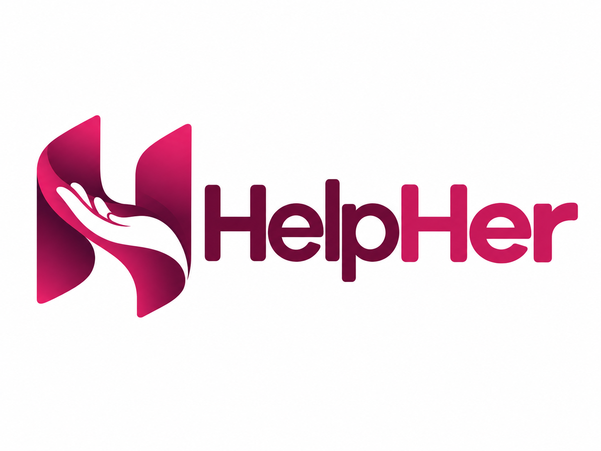

<p align="center">
  
</p>

<p align="center">
  <strong>Reconhecimento automático do Gesto Universal de Ajuda em vídeo,<br>
  voltado a centrais de monitoramento.</strong>
</p>

<p align="center">
  
  
  
  
  
</p>

---

## Contexto

O Gesto Universal de Ajuda é um sinal silencioso criado pela Canadian Women's
Foundation para que uma vítima de violência possa pedir socorro sem falar.
Sua eficácia depende de alguém reconhecer o gesto, o que limita seu alcance
em ambientes monitorados por câmera.

O HelpHer investiga o reconhecimento automático desse gesto e o encaminhamento
do alerta a um operador humano, que permanece como etapa final de verificação.

## Arquitetura

O sistema é dividido em dois módulos, desenvolvidos em paralelo.

```
vídeo  →  [ Percepção ]  →  landmarks  →  [ Decisão ]  →  alerta
```

| Módulo | Responsabilidade | Tecnologias |
| :--- | :--- | :--- |
| **Percepção** | Detecta e rastreia pessoas, localiza as mãos e extrai 21 landmarks por mão a cada quadro | YOLO11, ByteTrack, MediaPipe Hands |
| **Decisão** | Classifica a evolução temporal das sequências e aciona o alerta | TensorFlow, Keras, scikit-learn, MQTT, WebSocket |

## Módulo de percepção

Opera em modo offline sobre vídeos processados em lote.

- Detecção de pessoas quadro a quadro com YOLO11
- Rastreamento multiobjeto com ByteTrack, mantendo identificadores temporários
- Extração dos landmarks das mãos associadas a cada pessoa rastreada
- Avaliação em diferentes condições de iluminação, distância, ângulo, oclusão
  e número de pessoas em cena

## Módulo de decisão

O gesto é dinâmico: a mão se abre, o polegar se dobra sobre a palma e os demais
dedos se fecham sobre ele. Reconhecê-lo exige modelar a ordem dos quadros, e não
apenas a configuração da mão em um instante.

**Pré-processamento**
- Segmentação em janelas deslizantes de 45 quadros a 30 fps
- Normalização espacial relativa ao punho, invariante a escala e posição

**Classificação**
- Rede recorrente com memória (LSTM) sobre as sequências de landmarks
- Comparação com um classificador de referência não recorrente, para medir
  o ganho da modelagem temporal

**Validação**
- Avaliação por janela e por evento em vídeo contínuo
- Taxa de falsos positivos por hora como métrica operacional

**Alerta**
- Acionamento por MQTT e WebSocket

## Interface entre os módulos

A percepção entrega um arquivo tabular com uma linha por mão detectada por
quadro, consumido pelo módulo de decisão.

| Campo | Descrição |
| :--- | :--- |
| `video_id`, `frame`, `timestamp_s` | Identificação temporal |
| `frame_width`, `frame_height` | Dimensões do quadro, em pixels |
| `person_id`, `person_conf` | Identificador atribuído pelo rastreador e confiança |
| `bbox_x1` … `bbox_y2` | Caixa delimitadora da pessoa, em pixels |
| `hand_side`, `hand_conf`, `hand_detected` | Lateralidade real da mão, confiança e indicador de detecção |
| `lm0_x` … `lm20_z` | Coordenadas dos 21 landmarks |

As coordenadas `x` e `y` são normalizadas pelas dimensões do quadro e `z` segue
a convenção do MediaPipe. Cada mão é identificada pelo par
`person_id` + `hand_side`.

## Status

> Em desenvolvimento.
>
> Projetos de Iniciação Científica do Instituto Federal de São Paulo,
> Campus Jacareí.

## Aviso

> ⚠️ Este é um projeto de pesquisa acadêmica, **sem validação para uso
> operacional**. O sistema é concebido como ferramenta de apoio, com verificação
> humana obrigatória antes de qualquer resposta.
>
> As gravações utilizadas no desenvolvimento envolvem participantes voluntários
> sob termo de consentimento e **não são distribuídas neste repositório**.

## Autoria

| Módulo | Responsável |
| :--- | :--- |
| Módulo de percepção | Maria Clara Pastor da Silva |
| Módulo de decisão | Camila Ribeiro |
| Orientação | Ana Paula Shiguemori |

## Licença

(A definir.)
